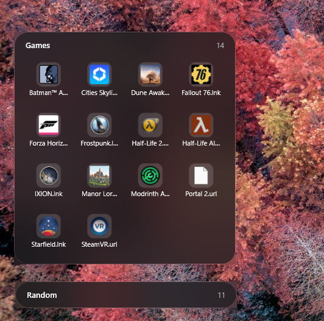
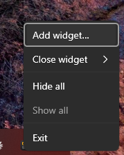

# Floating Window Organizer

iOS-style folder widgets for the Windows desktop. Each widget is a frosted-glass card
showing the contents of a folder you choose as a grid of icons. Widgets live on the
desktop layer: they sit above the wallpaper and below your app windows, and stay
visible when you press Win+D (Show desktop). Light and dark mode follow Windows.

Pin your Games folder, your Projects folder, a shared Random folder of odds and ends —
whatever you'd otherwise dig for in File Explorer — and glance at it right from the
desktop instead.

## Screenshots

An expanded widget ("Games") showing its grid of icons, and a collapsed widget
("Random") below it showing just the title row and item count:



The tray icon's right-click menu:



## Features

- **Live folder view** — each widget mirrors a folder you pick, rendered as a grid of
  shell icons with their real thumbnails (app icons, image previews, etc.).
- **Multiple widgets** — pin as many folders as you want, each its own independently
  positioned and sized card.
- **Collapsible** — shrink a widget down to just its title bar and item count when you
  don't need the contents visible.
- **Overflow tile** — when a folder has more items than fit, a **+N** tile opens the
  folder in File Explorer instead of truncating silently.
- **Desktop-layer pinning** — widgets sit above the wallpaper and below normal
  windows, stay out of the taskbar and Alt+Tab, and remain visible on Show desktop
  (Win+D).
- **Light/dark aware** — frosted-glass styling follows the current Windows theme.
- **Custom names and colors** — rename any widget, or tint its glass any color with a
  full-spectrum picker and opacity slider; text switches between black and white to stay
  readable.
- **Tray-resident** — runs from the notification area; left-click to hide/show all
  widgets at once, right-click for the full menu (see screenshot above).
- **Persistent layout** — each widget's folder, position, size, collapsed state, name
  and color are saved to disk and restored on the next launch.

## Using it

| Action | How |
|---|---|
| Move a widget | Drag anywhere on it. Its position is saved when you let go. |
| Open a file or folder | Double-click its icon |
| See items that don't fit | Double-click the **+N** tile (opens the folder in File Explorer) |
| Collapse to just the title row, or expand again | Double-click the title row, or right-click > **Collapse** / **Expand** |
| Re-read the folder after files change | Right-click > **Refresh** |
| Rename a widget | Right-click > **Rename**, type, press Enter (Esc cancels). Clear the name to go back to the folder's name. |
| Give a widget its own color | Right-click > **Color…**: pick a hue, shade and opacity (or type a hex value, or click a preset). **Default** returns to the Windows light/dark color. Text turns black or white automatically to stay readable. |
| See the version, or find the author's GitHub, LinkedIn and Buy Me a Coffee pages | Right-click a widget or the tray icon > **About** |
| Change folder, size (Small / Medium / Large), add, remove, exit | Right-click the widget |

Widgets don't appear in the taskbar or Alt+Tab.

### Tray icon

The app runs in the notification area (next to the clock), even with no widgets.

| Action | How |
|---|---|
| Hide or show every widget | Left-click the tray icon. Hidden widgets stay hidden after a restart. |
| Add widget, Close widget (pick one), Hide all, Show all, About, Exit | Right-click the tray icon |

## Design

Colours, type, sizes, components and the app icon are documented in the
[Floating Window Organizer design system](https://claude.ai/artifact/F66iK2hjPvQfVSmr9UnrDT)
(Claude Design; ask the maintainer for access). The code is the source of truth: if the two
disagree, `WidgetPalette.cs`, `WidgetLayout.cs` and `FolderWindow.xaml` win.

## Requirements

- Windows 11 (22H2 or later)
- [.NET 10 SDK](https://dotnet.microsoft.com/download)

## Solution layout

| Project | Target | Purpose |
|---|---|---|
| `src/FloatingWindowOrganizer.App` | `net10.0-windows` (WPF) | Widget windows, desktop pinning, blur, shell icons |
| `src/FloatingWindowOrganizer.Core` | `net10.0` | Settings, widget sizes and layout, theme palette, folder listing |
| `tests/FloatingWindowOrganizer.Tests` | `net10.0` (xUnit) | Unit tests for Core |
| `tests/FloatingWindowOrganizer.AppTests` | `net10.0-windows` (xUnit) | Unit tests for App-layer pure logic (`WidgetTheme`) |
| `tests/FloatingWindowOrganizer.TestSupport` | `net10.0` | Shared helpers for Smoke/E2E: launching an isolated app instance, locating the built exe |
| `tests/FloatingWindowOrganizer.Smoke` | `net10.0` (xUnit) | Launches the real built app; checks it starts/exits without crashing |
| `tests/FloatingWindowOrganizer.E2E` | `net10.0-windows` (xUnit, FlaUI) | Drives the real widget window and color picker via UI Automation |

## Build, test, run

```powershell
dotnet build
dotnet test                                                    # unit tests only (fast)
dotnet test tests\FloatingWindowOrganizer.Smoke                # launches the real app
dotnet test tests\FloatingWindowOrganizer.E2E                  # drives the real app's UI
dotnet run --project src/FloatingWindowOrganizer.App
```

### Testing

Smoke and E2E tests launch the real `FloatingWindowOrganizer.exe`, so build the solution first.
Each test gets its own isolated settings folder and single-instance mutex via two environment
variables the app honors only when set — `FWO_SETTINGS_DIR` (overrides where `settings.json` is
read/written) and `FWO_INSTANCE_ID` (suffixes the single-instance mutex name) — so tests never
touch your real `%APPDATA%\FloatingWindowOrganizer\settings.json` or collide with an instance of
the app you already have running. Both are no-ops for a normal launch.

E2E automates the widget window and color picker directly; driving the system tray's
notification-area menu is intentionally out of scope (too inconsistent across machines/CI
runners to automate reliably), as is the native folder-picker dialog used by "Add widget" and
"Change folder".

## Building the installer

Requires [Inno Setup 6.3+](https://jrsoftware.org/isinfo.php) (`winget install JRSoftware.InnoSetup`).

```powershell
.\build\build-installer.ps1              # version from Directory.Build.props
.\build\build-installer.ps1 -Version 0.2.0
```

Output: `artifacts\installer\FloatingWindowOrganizer-Setup-<version>.exe`. It installs for the
current user only (no admin prompt), bundles the .NET runtime, adds a Start menu shortcut, and
offers to start the app when you sign in.

### Releasing

Push a version tag and GitHub Actions builds the installer and attaches it to a GitHub Release:

```powershell
git tag v0.1.0
git push origin v0.1.0
```

## Settings

Saved as JSON at `%APPDATA%\FloatingWindowOrganizer\settings.json`: one entry per widget
with its folder, position, size and whether it's collapsed. On first run (no widgets yet) you're asked to pick a folder.

Uninstalling keeps this file, so reinstalling restores your widgets.
