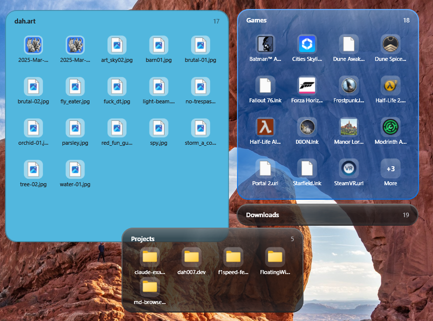
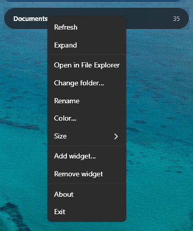
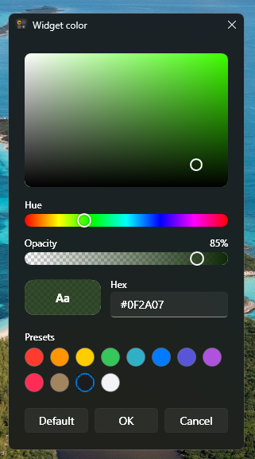
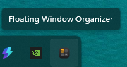
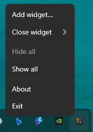

# Floating Window Organizer

**Your favorite folders, always on your desktop.** iOS-style folder widgets for Windows 11.

  

I've always wanted a quick-access folder that's always there, in the same spot on my
desktop — so I built this small app (with the help of Claude). Each widget is a
glossy glass card showing the contents of a folder you choose as a grid of icons. Pin your
Games, your Downloads, that project folder you open twenty times a day, and glance at it
right from the desktop instead of digging through File Explorer.

## Features

### 🗂️ Your folders, at a glance

- **Live folder view** — every widget mirrors a real folder, with real shell icons and
  thumbnails: app icons, image previews, the works.
- **As many as you want** — pin any number of folders, each placed wherever you drag it.
- **Four sizes** — Small (2 × 2), Medium (4 × 2), Large (4 × 4) or Extra large (5 × 5), per widget.
- **Never truncated silently** — when a folder holds more than fits, a **+N More** tile
  opens it in File Explorer.
- **Collapsible** — fold a widget down to just its title and item count when you don't
  need the contents.

### 🖥️ Part of the desktop, not in your way

- **Lives on the desktop layer** — above the wallpaper, below your app windows.
- **Survives Show desktop** — widgets stay put when you press **Win+D**.
- **Out of the taskbar and Alt+Tab** — no clutter where you switch apps.
- **Matches Windows** — the glass follows your light or dark theme.

### 🎨 Make each one yours

- **Rename** any widget — or clear the name to go back to the folder's.
- **Tint the glass** any color, with a full-spectrum picker, opacity slider, hex entry and
  presets.
- **Glossy glass** — a soft glare along the top, a diagonal streak and a light-to-dark edge,
  on any color. Turn it off per widget with right-click > **Glossy**.
- **An edge that matches** — the 2 px border is a shade of the widget's own color: darker on
  light glass, lighter on dark glass.
- **Always readable, on any wallpaper** — text flips between black and white to suit the color
  you pick *and* the wallpaper behind it, and pale colors over dark wallpapers (or the reverse)
  get a little more opaque so the text never sinks into the background.

  
  &nbsp;&nbsp;
  

### ⚙️ Set it and forget it

- **Runs from the tray** — even with no widgets. Left-click the icon to hide or show
  everything at once; right-click for the full menu.
- **Remembers everything** — folder, position, size, collapsed state, name and color all
  come back on the next launch.
- **Starts with Windows** — optional, chosen during install.
- **Never doubled up** — launching it again while it's running won't duplicate your widgets.

  
  &nbsp;&nbsp;
  

## Install

Download `FloatingWindowOrganizer-Setup-<version>.exe` from the
[Releases page](https://github.com/dah007/floating-window-organizer/releases) and run it.

- Installs for the current user only — no admin prompt.
- Bundles the .NET runtime; nothing else to install.
- Adds a Start menu shortcut and optionally starts the app when you sign in (toggle it later in **Settings > Apps > Startup**).
- Upgrading over an existing install closes the running copy first and restarts it after.
- Uninstalling stops the app but keeps your settings, so reinstalling restores your widgets.

On first run you're asked to pick a folder for your first widget.

## Using it

| Action | How |
| --- | --- |
| Move a widget | Drag anywhere on it. Its position is saved when you let go. |
| Open a file or folder | Double-click its icon |
| See items that don't fit | Double-click the **+N** tile (opens the folder in File Explorer) |
| Collapse to just the title row, or expand again | Double-click the title row, or right-click > **Collapse** / **Expand** |
| Re-read the folder after files change | Right-click > **Refresh** |
| Rename a widget | Right-click > **Rename**, type, press Enter (Esc cancels). Clear the name to go back to the folder's name. |
| Give a widget its own color | Right-click > **Color…**: pick a hue, shade and opacity (or type a hex value, or click a preset). **Default** returns to the Windows light/dark color. Text turns black or white automatically to stay readable against the color and your wallpaper, and the border takes a shade of the color. |
| Turn the glossy look on or off | Right-click > **Glossy** (on by default) |
| See the version, or find the author's GitHub, LinkedIn and Buy Me a Coffee pages | Right-click a widget or the tray icon > **About** |
| Change folder, size (Small / Medium / Large / Extra large), add, remove, exit | Right-click the widget |

Widgets don't appear in the taskbar or Alt+Tab.

### Tray icon

The app runs in the notification area (next to the clock), even with no widgets.

| Action | How |
| --- | --- |
| Hide or show every widget | Left-click the tray icon. Hidden widgets stay hidden after a restart. |
| Add widget, Close widget (pick one), Hide all, Show all, About, Exit | Right-click the tray icon |

## Settings

Saved as JSON at `%APPDATA%\FloatingWindowOrganizer\settings.json`: one entry per widget
with its folder, position, size, collapsed state, custom name, color and glossy setting, plus whether
widgets are currently hidden. Uninstalling keeps this file.

## Development Guide

[Development Guide](DEVELOPMENT_GUIDE.md)

## License

See [LICENSE](LICENSE).
